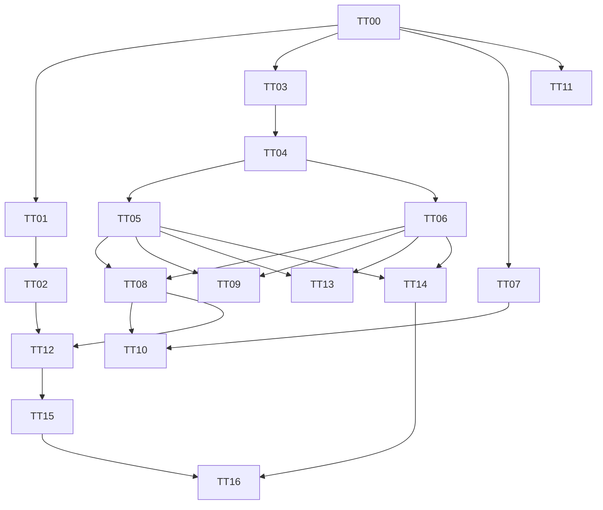

# 文件所有权与任务看板

远端基线 10202a6fc356abcee8e4d6b485bc58be45298875。Git fetch已成功，所有工作树已同步目标基线。原工作区保持不变。

只读审查完成，01/03/07已分派实现，其他角色按依赖排队，最多三名子Agent活跃；不是17名同时施工。

|任务|负责人角色|独占路径|依赖|状态|
|---|---|---|---|---|
|TT-00|总控架构 Agent|docs/architecture-contract-v2.md; docs/agent-file-ownership.md; 三套contracts|无|待审查|
|TT-01|Python安全 Agent|services/ingestion/server.py; services/ingestion/tests/security_*|00|进行中|
|TT-02|API安全 Agent|src/app/api/**; src/lib/agent/http.ts|00;01契约|待开始|
|TT-03|连接安全 Agent|src/lib/agent/providers.ts; transport.ts; src/lib/investigator/connections.ts|00|进行中|
|TT-04|阶段授权 Agent|src/lib/investigator/runtime.ts; tests/agent-stage-*|00;03契约|待开始|
|TT-05|引用验证 Agent|src/lib/agent/runner.ts; src/lib/ai/validate.ts; shared-model.ts|04|待开始|
|TT-06|存储恢复 Agent|src/lib/investigator/store.ts; scripts/investigator-worker.ts; migrations|04|待开始|
|TT-07|评估 Agent|evals/**; scripts/eval-*; .github/workflows/agent-evals.yml|00|进行中|
|TT-08|检索 Agent|src/lib/evidence-index/**; src/lib/search/**|05;06|待开始|
|TT-09|会话 Agent|src/lib/conversation/**; src/components/truthtrace/agent-panel.tsx|05;06|待开始|
|TT-10|动态规划 Agent|src/lib/investigator/runtime.ts; plan/**|04;05;06;07;08|待开始|
|TT-11|媒体引用UI Agent|src/components/truthtrace/evidence-content.tsx; contract-workbench.tsx|00 locator;历史定位等05/06|待开始|
|TT-12|案件搜索 Agent|src/components/truthtrace/case-search/**; API释放后新搜索路由|02;06;08|待开始|
|TT-13|承诺 Agent|src/lib/commitments/**; src/components/truthtrace/commitments/**|05;06|待开始|
|TT-14|导出 Agent|src/lib/report-render/**; report-preview/**; src/components/truthtrace/case-view.ts; src/components/truthtrace/case-view.test.ts|05;06;11释放导出接线|待开始|
|TT-15|可视化 Agent|src/components/relationship-graph.tsx; timeline.tsx|05;12|待开始|
|TT-16|部署文档 Agent|README.md; docs/DEPLOYMENT.md; PRIVACY.md; TESTING.md|已实施任务验收|待开始|

## 依赖与调度

边表示契约或验收门槛，并非所有节点都必须等待完整实现。首批建议01/03/07开始；03契约冻结后04，01契约冻结后02；11仅稳定ID与歧义提示可并行，历史版本定位等05/06。实际最多3个实现Agent。
第一批安全与正确性回归完成再启动05/06/08及后续任务。
runtime：04完成并释放后10；runner：05完成后09。08接入runner/runtime必须交给当期所有者或独立串行集成PR。store只有06写；其他模块提接口需求。API由02释放后其他任务才可新增路由。
公共schema由00管理 src/lib/contracts.ts、src/lib/agent/contracts.ts、src/lib/investigator/contracts.ts。contract-workbench由11独占，13/14接线串行。package.json/锁文件/公共测试配置由00协调，不并发编辑。
PR顺序：00文档审查→各安全PR独立审查→整合回归→05/06→08→后续。每PR附复现、测试、兼容、风险与回滚。维护待开始/进行中/待审查/阻塞/已完成状态，不把分派标为完成。
## 2026-11-04 第一批实施记录
远端main仍为10202a6。独立PR：TT00 #17，TT03 #18，TT04 #19，TT07 #20，TT11第一阶段 #21，TT01 #22，TT02 #23。全部draft，未合并main。
当前集成分支integration/tt-v2-20261104。121项单测通过，Next webpack生产构建通过；默认Turbopack受工作树node_modules junction限制，不能将webpack通过写成默认build通过。浏览器四条回归正在运行。
独立审查已修：固定DNS lookup all回调、流结束后释放并发、所有默认启动回环绑定、setup日志脱敏、结构化官方设备登录URL、Next route typegen签名。渠道调查已接受控ingestionFetch。
TT01仍有stateful source/parse_chat CPU隔离、OS内存隔离及独立大附件归档待处理；当前仅受控本机候选，不批准公网。
TT07生产路径离线基线70/73、候选73/73；语义质量NOT_MEASURED，gold待人工审核，不冒充真实模型验证。
TT05/06/08仍等待第一批检查门槛，未开始核心修改。

## 最终候选看板（取代前述过程状态）
TT00–TT16均已派发并有实际代码/文档与独立PR；当前统一为“待审查”，不以代码提交代替验收完成。TT01的stateful source隔离、TT05逐主张语义验证、TT07独立人工/真实模型评估等未完成范围见RELEASE-CANDIDATE.md。所有核心文件并发所有权已释放；最后审查修复只由指定所有者串行处理。主分支未合并。

## 用户授权合并后的审查记录

本轮 #17–#36 的代码审查已完成，用户已明确授权合入 main；由总集成 PR #24 保留全部任务祖先关系统一交付，GitHub PR 状态作为实际合并结果。上述“待审查”看板为初次候选记录。三个独立审查 Agent 已核对所有任务 head 的补丁均被集成，历史补齐提交没有改变源码树。完整 UI 与后续安全修复保留；不得把合并状态当作真实模型评估或未实现功能验收完成。
